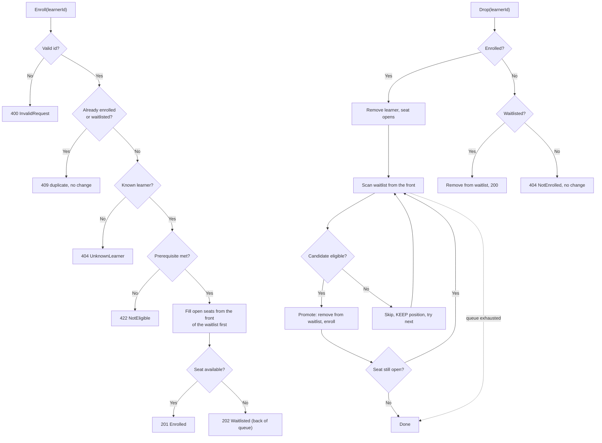

# HTTP API Guide and Test Runner Notes

This guide covers the optional HTTP API in detail (Windows PowerShell and bash examples, every status code) and the request flow.
For the console, the guided demo and the test commands, see the main [README](../README.md).

Start the API from the folder that contains `CourseWaitlist.sln`:

```
dotnet run --project src/CourseWaitlist.Api --urls http://localhost:5090
```

Defaults (`src/CourseWaitlist.Api/appsettings.json`): offering `NET301`, capacity `2`, prerequisite `CSH101`. The API starts with no
learners and works with learner IDs only; register learners with `PUT /learners/{id}`.

## Try the HTTP API (Windows PowerShell)

In PowerShell `curl` is an alias, so use `Invoke-RestMethod`. Run each line separately.

Error responses (409, 422, 404) are raised as PowerShell errors. Windows PowerShell does not always show the response body, so
define this helper once to print the server's `status` and `message`:

```powershell
function Show-Body($e) { if ($e.ErrorDetails.Message) { $e.ErrorDetails.Message } else { (New-Object System.IO.StreamReader($e.Exception.Response.GetResponseStream())).ReadToEnd() } }
```

```powershell
$u = 'http://localhost:5090'
# register learners (stand-in for a student-records source): L101-L103 completed CSH101, L107 has not
foreach ($n in 'L101','L102','L103') { Invoke-RestMethod -Method Put -Uri "$u/learners/$n" -ContentType 'application/json' -Body '{"completedCourses":["CSH101"]}' }
Invoke-RestMethod -Method Put -Uri "$u/learners/L107" -ContentType 'application/json' -Body '{"completedCourses":["JS101"]}'

# enroll: L101, L102 get seats (capacity 2), L103 is waitlisted, L107 is rejected with NotEligible
foreach ($n in 'L101','L102','L103','L107') { try { Invoke-RestMethod -Method Post -Uri "$u/offering/enrollments" -ContentType 'application/json' -Body "{`"learnerId`":`"$n`"}" } catch { Show-Body $_ } }

# drop L101: L103 is promoted
Invoke-RestMethod -Method Delete -Uri "$u/offering/enrollments/L101"
# drop L101 again: NotEnrolled, no state change
try { Invoke-RestMethod -Method Delete -Uri "$u/offering/enrollments/L101" } catch { Show-Body $_ }

Invoke-RestMethod "$u/offering"
```

Bash / Git Bash equivalents:

```bash
curl -i -X PUT localhost:5090/learners/L101 -H 'Content-Type: application/json' -d '{"completedCourses":["CSH101"]}'
curl -i -X POST localhost:5090/offering/enrollments -H 'Content-Type: application/json' -d '{"learnerId":"L101"}'
curl -i -X DELETE localhost:5090/offering/enrollments/L101
curl localhost:5090/offering
```

## API summary

| Request | Outcome | HTTP |
|---|---|---|
| `POST /offering/enrollments` `{learnerId}` | enrolled / waitlisted (with position) | 201 / 202 |
| | already enrolled or already waitlisted (no change) | 409 |
| | prerequisite not met | 422 |
| | unknown learner / blank or invalid id | 404 / 400 |
| `DELETE /offering/enrollments/{learnerId}` | dropped (+ promoted learner) / removed from waitlist | 200 |
| | not enrolled or waitlisted, including a repeated drop (no change) | 404 |
| `GET /offering` | capacity, seats available, enrolled, waitlist (in order) | 200 |
| `PUT /learners/{id}` `{completedCourses}` | set learner records, then fill any open seats | 200 |

## How it works



All state changes happen inside one lock in `EnrollmentService`, so capacity and the waitlist can never be corrupted by
concurrent requests. See the design spec for invariants, trade-offs and the concurrency approach.

## Test runner

The build sandbox had no NuGet access, so the tests use an xUnit-compatible shim (`MiniXunit.cs`, same `[Fact]` and
`Assert.*` API) and the test project is a console app, which is why the command is `dotnet run` and not `dotnet test`.
To use real xUnit: delete `MiniXunit.cs` and `Program.cs`, add the `Microsoft.NET.Test.Sdk`, `xunit` and
`xunit.runner.visualstudio` packages, set `OutputType` to `Library`, remove `nuget.config`, then use `dotnet test`.
