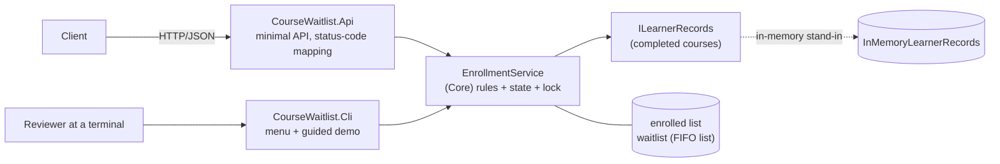

# Design Specification: Course Waitlist (one offering)

## 1. Scope and service boundary

In scope: enrollment, drop and FIFO waitlist promotion for **one** course offering.
Out of scope (per the brief): frontend, course catalog, payments, identity integrations, multi-term registration, deployment,
a database, and a configurable policy engine.



- **Core** (`CourseWaitlist.Core`) contains every rule and all state. It has no web dependency and is tested directly.
- **Api** (`CourseWaitlist.Api`) only translates requests/results to HTTP. It holds no business logic.
- **Cli** (`CourseWaitlist.Cli`) is a second thin front end over the same service: an interactive menu with sample learners
  preloaded, and a `--demo` mode that runs the full scenario and checks every result. It exists so a reviewer can see the
  behaviour without typing setup commands. Like the API, it holds no business logic.
- `ILearnerRecords` is the single seam to "who is this learner and what have they completed". It is stubbed in memory; the real
  source (identity, student records) is out of scope.

## 2. Assumptions (stated as required)

**Prerequisite**
- An offering has at most one required prerequisite course code (`RequiredPrerequisite`, null = none).
- A learner is **eligible** when that code is in their completed courses (case-insensitive). A learner with no record is unknown and rejected (`404`).

**Waitlist and ineligible learners**
- Only **eligible** learners can enroll or join the waitlist. An ineligible learner is rejected at enrollment (`422`) and is never stored.
- Eligibility is **re-checked at promotion time**, because learner records can change while someone waits.
- **Policy: SKIP and RETAIN.** When an ineligible learner is at the front, they are skipped, **keep their position**, and are re-checked the
  next time seats are filled. They are never enrolled or promoted while ineligible. The same rule is applied everywhere seats are filled
  (drop, new enrollment, record update).
- A new learner who joins the waitlist goes to the back. A learner who drops and re-enrolls also goes to the back.
- An open seat is always offered to the front of the waitlist before a new enrollee can take it.

**Identity and requests**
- Learner id: trimmed, 1-64 characters, no control characters, compared **case-sensitively**.
- Duplicates are detected by normalized id across enrolled + waitlist; a duplicate request changes nothing and says so.
- Dropping a **waitlisted** learner removes them from the queue without freeing a seat. Dropping anyone not on the course (including a
  repeated drop) changes nothing and returns a clear `NotEnrolled` result.

## 3. Data model (in memory)

| Item | Type | Notes |
|---|---|---|
| `OfferingConfig` | `OfferingId`, `Capacity` (> 0), `RequiredPrerequisite?` | immutable, validated in the constructor |
| enrolled | `List<string>` | learner ids, in enrollment order |
| waitlist | `List<string>` | learner ids, index 0 = front of queue |
| `Learner` | `Id`, `CompletedCourses` (case-insensitive set) | read through `ILearnerRecords` |

Two plain lists were chosen over lists plus index sets so that membership and order can never drift apart. For one offering,
O(n) lookups are fine (see limitations).

## 4. API

| Request | Result | HTTP |
|---|---|---|
| `POST /offering/enrollments` `{learnerId}` | `Enrolled` | 201 |
| | `Waitlisted` + `waitlistPosition` | 202 |
| | `AlreadyEnrolled` / `AlreadyWaitlisted` | 409 |
| | `NotEligible` | 422 |
| | `UnknownLearner` | 404 |
| | `InvalidRequest` | 400 |
| `DELETE /offering/enrollments/{learnerId}` | `Dropped` (+ `promotedLearnerIds`, `skippedLearnerIds`) or `RemovedFromWaitlist` | 200 |
| | `NotEnrolled` (also a repeated drop) | 404 |
| `GET /offering` | snapshot: capacity, seatsAvailable, enrolled, waitlist | 200 |
| `PUT /learners/{id}` `{completedCourses}` | upsert records, then `FillOpenSeats` (returns promoted ids) | 200 |

Every response carries a `status` and a human-readable `message`. `GET /health` is a liveness probe.

## 5. Invariants

| | Invariant | Enforced by |
|---|---|---|
| I1 | enrolled count <= capacity | single lock; capacity check and add are one atomic step |
| I2 | a learner appears at most once across enrolled + waitlist | duplicate checks under the same lock |
| I3 | waitlist keeps arrival order; a skipped learner keeps their position | append-only join; promotion removes only the promoted element |
| I4 | an ineligible learner is never enrolled or promoted | eligibility checked at enrollment and again at every promotion |
| I5 | an open seat is offered to the front of the waitlist before any new enrollee | `Enroll` fills open seats from the queue before its capacity check |

## 6. Algorithms

`FillOpenSeats` (the only place that promotes):

```
index = 0
while enrolled.Count < capacity and index < waitlist.Count:
    candidate = waitlist[index]
    if candidate has a record and is eligible:
        remove waitlist[index]; add candidate to enrolled      # index stays: next candidate slid into it
    else:
        record candidate as skipped; index++                   # retained in place
```

- **Enroll:** validate id → duplicate check → known learner → eligible → `FillOpenSeats` → enroll if a seat is free, else join the back of the waitlist.
- **Drop:** validate id → if enrolled: remove, `FillOpenSeats`; else if waitlisted: remove; else `NotEnrolled`.
- Multiple open seats (for example after skipped learners) are all filled in one pass, in FIFO order.

## 7. Concurrency and persistence

- **Pattern:** one `lock (_gate)` on a `System.Threading.Lock` (the dedicated lock type added in .NET 9) guards all reads and writes of the lists inside `EnrollmentService`. There is exactly one service instance
  (a singleton), so the lock is the transaction boundary. Every public operation completes entirely inside it, so no caller can ever observe
  a half-applied change; `Snapshot()` copies state under the same lock.
- **Why a plain lock:** the invariants span several pieces of state (count vs capacity, two lists), so lock-free or per-collection
  thread-safe types would not make check-then-act atomic. The critical sections are tiny and in-memory, so contention is not a concern for one offering.
- **Persistence:** in memory only, as allowed by the brief for a fallback. State is lost on restart. See limitations for the production path
  (a transaction with a row lock or optimistic concurrency on the offering).
- Learner-record lookups happen inside the lock; the in-memory implementation is non-blocking. A remote records source would need to
  be prefetched or its latency accepted.

## 8. Trade-offs

| Decision | Why | Alternative not taken |
|---|---|---|
| Skip and retain ineligible learners | Fair to people who joined first; no silent loss of position; one consistent rule | Remove them from the queue; or block the queue behind them (head-of-line blocking) |
| Reject ineligible learners at enrollment | Matches the acceptance criteria; keeps the queue clean | Let them wait in case they qualify later |
| Re-check eligibility at promotion | Records can change while waiting | Trust the check made at join time |
| Single lock and plain lists | Simplest correct design for one offering | Concurrent collections, actors, or a database |
| 409 for duplicates, 404 for repeated drop | Explicit and distinguishable results | Idempotent 200 |
| Records behind `ILearnerRecords`, no policy interface | Scope boundary: no configurable policy engine | Pluggable eligibility rules |

## 9. How the acceptance criteria are covered

| Criterion | Tests (all in `tests/CourseWaitlist.Tests`) |
|---|---|
| 1 Enroll with capacity and prerequisite | `Enrolls_when_capacity_remains...`, `Fills_to_capacity...`, `Prerequisite_comparison_ignores_case` |
| 2 Full course, waitlist once, no duplicates | `Fills_to_capacity...`, `Duplicate_enroll_of_a_waitlisted_learner...`, `Duplicate_enroll_of_an_enrolled_learner...`, API `Duplicate_enroll_returns_409...` |
| 3 Drop promotes earliest eligible | `Drop_promotes_the_earliest...`, `Successive_drops_promote_in_arrival_order`, `A_learner_who_drops_and_re_enrolls...` |
| 4 Ineligible never enrolled/promoted; policy consistent | `Learner_without_the_prerequisite...`, `Ineligible_learner_at_the_front_is_skipped...`, `Skipped_learner_is_promoted_on_a_later_seat...`, `When_every_waitlisted_learner_is_ineligible...`, `A_new_enrollee_cannot_jump...` |
| 5 Invalid and repeated drops, state intact | `Blank_null_overlong...`, `Repeated_drop_is_reported_clearly...`, `Dropping_someone_who_never_enrolled...`, `Dropping_a_waitlisted_learner...`, API `Repeated_drop_returns_404...` |
| 6 Concurrency | `Many_learners_enrolling_at_once...`, `The_same_learner_requested_concurrently...`, `Concurrent_drops_of_the_same_learner...`, `Concurrent_promotion_attempts_into_one_open_seat...`, `Mixed_concurrent_enrolls_and_drops...`, API `Concurrent_http_enrollments...` |
| Whole-system property | `Randomised_operation_sequences...` (3000 random operations checked against a simple reference model after every step) |
| Reviewer walkthrough | Console `--demo` (16 checked steps covering criteria 1-5) and `CliTests` (menu driven with scripted input) |
